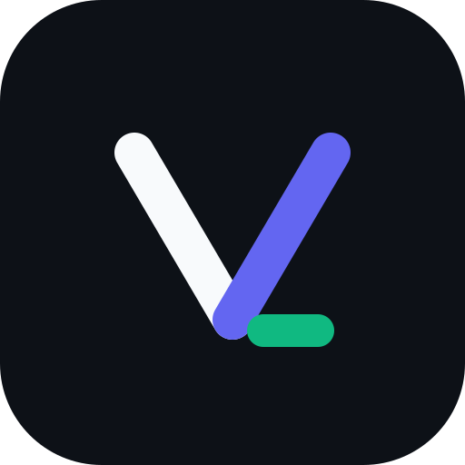
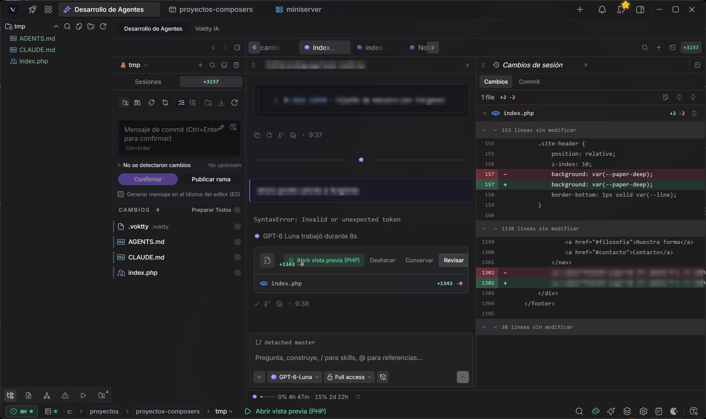
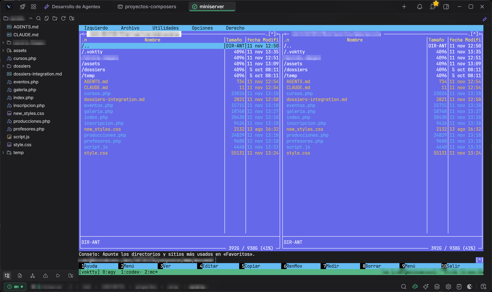
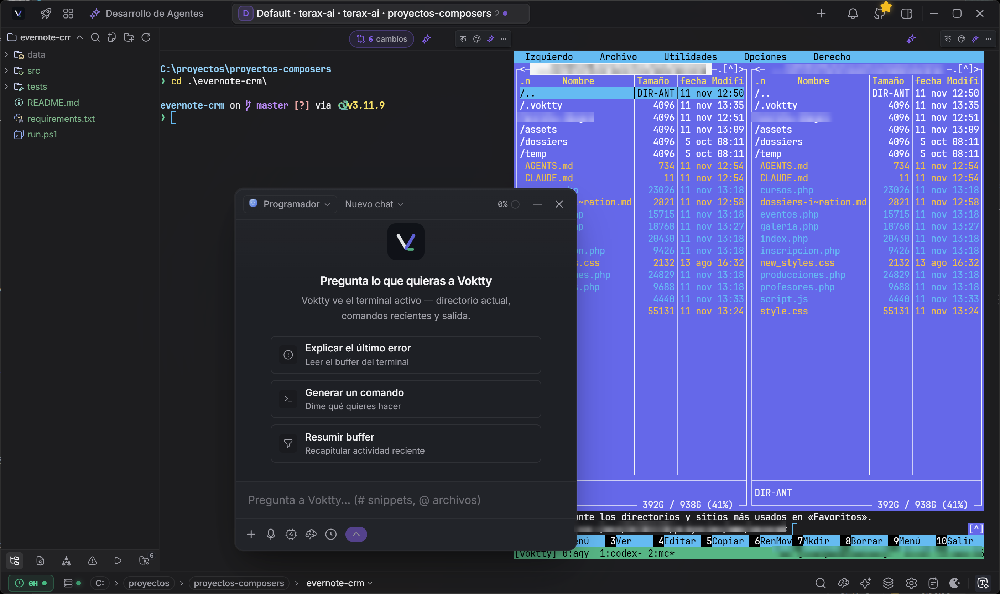

<div align="center">
  
  <h1>Voktty</h1>
  <p><strong>Рабочее пространство для ваших кодинг-агентов.</strong></p>
  <p><a href="https://voktty.dev">Сайт</a> · <a href="https://voktty.dev/docs">Документация</a> · <a href="https://github.com/voktty/voktty">Исходный код сайта</a></p>

  <p>
    
    
    
    <a href="https://discord.gg/z8mzebCzJB"></a>

  </p>
</div>

<p align="center">
  <a href="../../README.md">English</a> | <a href="README.zh-CN.md">简体中文</a> | <a href="README.es.md">Español</a> | <a href="README.de.md">Deutsch</a> | <a href="README.fr.md">Français</a> | <a href="README.ja.md">日本語</a> | <a href="README.ko.md">한국어</a> | <a href="README.pt-BR.md">Português</a> | <a href="README.pl.md">Polski</a> | <a href="README.id.md">Bahasa Indonesia</a> | <a href="README.hi.md">हिन्दी</a>
</p>

---

Voktty представляет собой открытое настольное рабочее пространство для ИИ-агентов программирования, созданное на Tauri 2, Rust и React 19. Его Agent Harness запускает Claude Code, Codex, Gemini (через Antigravity), Cursor, Grok, OpenCode, Pi и любую модель, доступную по API, в локальных и SSH-проектах, с подтверждениями, проверкой изменений, общей памятью проекта и координацией команд. Вокруг него находятся нативный терминал, редактор кода, Git и окружения: локальное, WSL, SSH, Docker, последовательное и удалённый рабочий стол. Без учётной записи и без телеметрии. Установщики весят от 25 до 36 МБ (v1.0.27; AppImage для Linux занимает около 118 МБ).

## Снимки экрана

На снимках используется испанский интерфейс; больше изображений в [галерее](../screenshots.md).

<p align="center">
  <br/><sub>Agent Harness: агент редактирует проект, а его изменения отображаются как diff, который можно сохранить или отменить</sub>
</p>

<p align="center">
  <br/><sub>SSH-проект: удалённые файлы рядом с живым терминалом на сервере</sub>
</p>

<p align="center">
  <br/><sub>Плавающий ИИ-чат, который читает каталог, последние команды и вывод активного терминала</sub>
</p>

## Что вы получаете

### Агенты

- **Много агентов в одном месте.** Сессии Claude Code, Codex, Antigravity (Gemini), Cursor, Grok, OpenCode и Pi работают бок о бок, каждая со своим CLI и своим входом.
- **Любая модель по API как агент.** Облачные провайдеры, собственные эндпоинты и локальные модели Ollama, LM Studio или MLX могут читать, искать, редактировать и выполнять команды в проекте с теми же проверками рабочей области и секретных путей, что и ИИ-чат. Цикл агента и ваш ключ остаются на вашем компьютере.
- **Вы решаете, что им разрешено.** Контролируемые сессии спрашивают перед каждой записью или командой, полный доступ не спрашивает. Правки отображаются как diff, который можно сохранить или отменить.
- **Агенты на ваших серверах.** В SSH-проектах Claude Code, Codex и OpenCode работают на хосте, и разрыв соединения их не останавливает. Модели API читают, ищут и редактируют удалённые файлы и выполняют команды, когда удалённый помощник обновлён.
- **Команды агентов.** Состав с ролями и правилами, доска того, кто работает или ждёт, оркестратор, который запускает остальных и пишет им, и журнал того, что они говорят друг другу и вам. См. [руководство по командам агентов](../guides/agent-teams.md).
- **Память и присутствие.** Просматривайте и восстанавливайте то, что агенты помнят о проекте, получайте уведомление, когда агент на любом открытом хосте ждёт вас, и следите за работающими агентами в необязательном Notch (альфа).

### Рабочее пространство вокруг них

- **Терминал.** Нативный PTY с рендерингом WebGL, режимы raw и блоками, панели, пространства и приватные терминалы.
- **Редактор.** CodeMirror 6 с необязательным LSP, ИИ-автодополнением и правками, Quick Open, а также поиском и заменой с предпросмотром.
- **Git.** Система контроля версий, история с графом коммитов, worktree и коммиты с помощью ИИ.
- **Окружения.** Локальное, WSL, SSH, Docker, последовательное и RDP, с сохранёнными подключениями, туннелями и панелью сервера.
- **Предпросмотр и инструменты.** Предпросмотр локальных серверов разработки (в том числе по SSH), просмотрщики медиа и PDF, API-клиент и MCP-клиент.
- **Спутник на телефоне.** Предварительная версия приложения для Android, которая связывается по QR-коду, чтобы следить за сессиями ИИ и управлять ими по локальной сети.

### Приватно по умолчанию

Без учётной записи и без телеметрии Voktty. Ключи провайдеров хранятся в связке ключей ОС, нативный доступ к файловой системе разрешается для каждой рабочей области, файловые инструменты ИИ отклоняют секретные пути, а любой изменяющий вызов инструмента сначала спрашивает, если вы не дали полный доступ.

Полный список возможностей находится в [docs/features.md](../features.md) (на английском).

## Установка

Последние установщики находятся на странице [Releases](https://github.com/voktty/voktty/releases/latest). Voktty автоматически обновляется оттуда.

### Примечания для Windows

- Определение shell по умолчанию: `pwsh.exe` (PowerShell 7+) -> `powershell.exe` (Windows PowerShell 5.1) -> `cmd.exe`.
- WSL является полноценной рабочей средой, а не обёрнутым подпроцессом.

### Примечания для Linux

- **Arch / AUR:** `yay -S voktty-bin` или `paru`. Пакет следует за последним выпуском.
- **NixOS / Nix:** используйте официальный flake. Вне NixOS выполните `nix profile install github:voktty/voktty`. В NixOS импортируйте flake и добавьте `inputs.voktty.packages.${pkgs.system}.voktty` в `environment.systemPackages`. Для более простой настройки доступен `nixosModules.voktty`.
- **AppImage:** требует FUSE. Без него выполните `./Voktty_*.AppImage --appimage-extract-and-run`. При проблемах рендеринга в Wayland попробуйте `WEBKIT_DISABLE_DMABUF_RENDERER=1`. Пакеты `.deb` / `.rpm` используют системный стек GTK и обычно работают плавнее.

## Настройка агентов и ИИ

1. **Агенты программирования.** Установите CLI используемых агентов (например, Claude Code или Codex) и войдите в них как обычно. Voktty находит их и использует их собственный вход. Для SSH-проектов установите их на сервере.
2. **Модели API.** Откройте настройки и перейдите в **Модели ИИ**, добавьте провайдера с ключом или собственный эндпоинт либо укажите Voktty локальный сервер LM Studio, MLX или Ollama. После этого модели появятся в выборе моделей Harness на вкладке **API**.
3. Ключи записываются в связку ключей ОС через `keyring` и никогда не попадают в `localStorage`. В Linux без шины сессии или Secret Service Voktty использует приватный резервный файл с режимом 0600.

## Сборка из исходного кода

**Требования**

- Rust (stable), https://rustup.rs
- Node 20+ и [pnpm](https://pnpm.io)
- Требования Tauri для вашей платформы, https://tauri.app/start/prerequisites/

**Запуск**

```bash
pnpm install
pnpm tauri dev          # разработка
pnpm tauri build        # производственный пакет
```

**Проверки**

```bash
pnpm lint
pnpm check-types
pnpm test
cd src-tauri && cargo clippy --all-targets --locked -- -D warnings   # Rust lint как в CI
cd src-tauri && cargo nextest run --locked                           # или cargo test --locked
```

## Стек технологий

Tauri 2, Rust, `portable-pty`, React 19, TypeScript, Vite, xterm.js, CodeMirror 6, Vercel AI SDK, Tailwind v4, shadcn/ui и Zustand.

## Участие в разработке

Issues и PR приветствуются. Сообщайте о проблемах, предлагайте возможности или отправляйте pull request. Подробности находятся в [CONTRIBUTING.md](https://github.com/voktty/voktty/blob/main/CONTRIBUTING.md) и [документации по архитектуре](../README.md). Направление проекта описано в [дорожной карте](../../ROADMAP.md).

## Состояние подписи платформ

Текущие предварительные сборки создаются без подписи кода операционной системы и без нотариального заверения для Windows и macOS. Windows SmartScreen и macOS Gatekeeper могут показывать предупреждения, поскольку установщики и пакеты приложения еще не признаны этими платформами доверенными.

Сами по себе эти предупреждения не доказывают наличие вредоносного ПО, но устанавливайте только сборку, загруженную из официальных каналов релизов Voktty, предварительно проверив ее контрольную сумму или подпись релиза. Подпись обновлятора Voktty не зависит от подписи операционной системы и защищает подлинность обновлений только при настроенном соответствующем ключе релиза.

Сертификаты платформ и нотариальное заверение будут добавлены до стабильного распространения.

<br clear="left" />

## Происхождение и атрибуция

Voktty является независимым форком Terax (Crynta), а его Agent Harness происходит от MonoCode (MIT, автор Nick). Ни один из авторов не связан с Voktty и не одобряет его. См. [NOTICE](../../NOTICE) и [LICENSE](../../LICENSE).

## Лицензия

Voktty распространяется по лицензии Apache-2.0. Информацию о зависимостях см. в [Apache License 2.0](https://github.com/voktty/voktty/blob/main/LICENSE).
